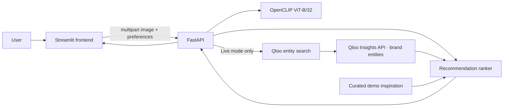

# StyleGraph AI

**Your aesthetic. Your culture. Your style.** A multimodal fashion discovery demo that compares outfit imagery and style language with a pretrained image-text model, then optionally connects a cultural reference to Qloo brand insights.

## What it does

- Analyze outfit images for broad aesthetic similarities and an approximate dominant color palette.
- Analyze text-only preferences using the same image-text embedding space.
- Generate ranked fashion-brand inspiration from a clearly labeled demo catalog, or from Qloo in explicit live mode.
- Explain recommendation provenance, expose available signals, and use likes/rejections to adjust rankings for the current session.
- Run without a Qloo credential in demo mode.

Qloo's Insights API returns brand entities as inspiration candidates, not products for sale. The integration does not invent prices, inventory, links, review counts, or affinity values. Its output candidates are drawn from Qloo's documented `urn:entity:brand` results. The current API contract was checked against Qloo's [hackathon developer guide](https://docs.qloo.com/reference/qloo-llm-hackathon-developer-guide). Qloo documents hackathon access at `https://hackathon.api.qloo.com`, an `X-Api-Key` header, `GET /search` for resolving named entities, and `GET /v2/insights` for insights; `/v2/insights` requires `filter.type`, and legacy `/recommendations` and `/recs` are unsupported. The live lookup uses a brand insights query from a resolved artist, brand, or movie entity. Supported query parameters vary by entity type and account entitlement; live responses remain unverified without a project API key.

## Architecture



## Stack and ML method

- Python 3.11, Streamlit, FastAPI, Pydantic, HTTPX, Pillow, NumPy, scikit-learn, PyTorch, OpenCLIP.
- The backend lazily loads OpenAI CLIP ViT-B/32 on CPU. It compares a preprocessed image embedding with curated text prompts for broad style categories using cosine similarity. The same model compares text preferences and candidate descriptions.
- CLIP similarity is not a calibrated probability and does not identify exact garments, labels, people, or sensitive attributes. Dominant colors use lightweight K-means over a downsampled image.
- The initial rank is deterministic and combines available visual and text similarities after a linear remapping to 0–1. A small session feedback boost is applied to liked candidates; rejected candidates are filtered. It is a heuristic, not a trained ranker. Qloo responses currently provide candidate discovery; no numeric Qloo affinity is claimed.
- OpenAI CLIP weights are downloaded by OpenCLIP on first inference and cached by the runtime. Review OpenAI's [CLIP repository and model terms](https://github.com/openai/CLIP) and the OpenCLIP package's model-specific notices before commercial redistribution. CPU-only inference can be slow; free instances can cold-start or run out of memory.

## Repository layout

```text
backend/app/       FastAPI API, schemas, settings and ML/Qloo/ranking services
backend/tests/     Backend API smoke tests
frontend/          Streamlit application and theme
```

## Run locally

Python 3.11 is recommended. The current dependency pins and PyTorch/OpenCLIP wheels may not support Python 3.14. Open two terminals from the repository root.

Backend (Windows PowerShell):

```powershell
cd backend
py -3.11 -m venv .venv
.\.venv\Scripts\Activate.ps1
python -m pip install -r requirements.txt
Copy-Item .env.example .env
uvicorn app.main:app --reload --port 8000
```

Frontend:

```powershell
cd frontend
py -3.11 -m venv .venv
.\.venv\Scripts\Activate.ps1
python -m pip install -r requirements.txt
streamlit run app.py
```

Open Streamlit at `http://localhost:8501`. Demo mode needs no credentials. For a general Python shell, replace activation with `. .venv/bin/activate`.

## Configuration

Backend variables are in `backend/.env.example`: `QLOO_API_KEY`, `QLOO_BASE_URL`, `BACKEND_MODE`, `FRONTEND_ORIGINS`, `MAX_UPLOAD_MB`, `MODEL_NAME`, and `MODEL_PRETRAINED`. Keep `QLOO_API_KEY` only in the backend environment. `BACKEND_MODE` sets the default reported health mode; individual analysis calls explicitly select demo or live. Live calls fail clearly when the key is missing and never fall back to sample data.

The Streamlit app reads `QLOO_API_KEY`, `QLOO_BASE_URL`, and `BACKEND_MODE` from Streamlit secrets or environment variables. The Qloo credential is used only by the Streamlit server process.

To enable live requests, request hackathon API access using Qloo's [official developer guide](https://docs.qloo.com/reference/qloo-llm-hackathon-developer-guide), then configure the provided key in the Streamlit server environment. A key's access and entity-type permissions are controlled by Qloo. If you also run the separate FastAPI backend, its `FRONTEND_ORIGINS` setting still applies.

## API

- `GET /health` — process health and configured mode.
- `GET /ready` — capability/configuration summary (model loads lazily on first inference).
- `POST /api/style/analyze` — multipart fields `profile_json`, optional `image`, and `mode` (`demo` or `live`).
- `POST /api/feedback` — session-feedback event acknowledgement; clients apply the returned preference on the next analyze request.

Uploads are limited to 8 MB by default, JPEG/PNG/WebP, and 20 megapixels. Decoding is validated before inference. Images are kept in request memory and not stored by this app.

## Tests

From `backend/` with dependencies installed:

```powershell
python -m pytest
```

Tests cover health, missing-input validation, and session feedback. No live Qloo request or image-model download is needed for those smoke tests. A model-backed image inference and live API request still need manual verification after installing dependencies and configuring access.

## Deployment

This repository can be deployed as a **single Streamlit app without Docker**. The Streamlit process now runs the vision model, recommendation ranker, and optional Qloo client in-process; the FastAPI backend remains available for local/API deployments but is not required by the Streamlit app.

Create a Streamlit Community Cloud app from this repository with:

- **Main file path:** `frontend/app.py`
- **Python version:** 3.11 (selected by the repository-level `runtime.txt`)

The complete Streamlit dependency set is declared in `frontend/requirements.txt`. In the app's **Settings → Secrets**, add:

```toml
QLOO_API_KEY = "your-key" # optional for demo mode
QLOO_BASE_URL = "https://hackathon.api.qloo.com"
BACKEND_MODE = "demo"
```

The app reads these values on the server and does not display the Qloo key to users. Open the deployed app and run a demo analysis first. The first image analysis downloads the OpenCLIP weights and may be slow on a free instance; CPU inference and cold starts can take several minutes. Use Python 3.11 and an instance with enough memory for PyTorch and OpenCLIP.

To enable live Qloo discovery, request hackathon API access using Qloo's [official developer guide](https://docs.qloo.com/reference/qloo-llm-hackathon-developer-guide), then add the issued key to Streamlit Community Cloud secrets:

```text
QLOO_API_KEY=your-key
BACKEND_MODE=demo
```

In the Streamlit-only deployment, “backend host” means the Streamlit server environment. The UI's live mode explicitly requests Qloo and does not silently fall back to demo recommendations. This repository is the public source for the project:

- Public repository: https://github.com/UzaibBashir/StyleGraph_AI
- Live demo URL: pending external publication; set the final deployed Streamlit URL here after hosting is completed.

## Submission checklist

Before the hackathon submission, verify the following:

1. The Streamlit app is live and publicly reachable.
2. Streamlit secrets contain `QLOO_API_KEY` if live mode is required.
3. Demo mode works without credentials.
4. Live mode works with a real cultural reference and returns Qloo results.
5. The public repo is visible in the GitHub About section under a visible open-source license.

## Limitations and next steps

- Live Qloo requests require an issued API key. Exact query behavior depends on current Qloo docs and account entitlement; test the `GET /search` and brand Insights request with the target account.
- The documented guide was readable, but individual reference pages may be dynamic. The service validates responses defensively and does not create synthetic live results.
- Candidate similarity is computed from a style brief and entity description/name; it is not a product match. Qloo candidates can be sparse for a given interest.
- Streamlit keeps feedback in session state only. There is no account system, permanent learning, database, or image retention.
- Free hosting may not have enough memory or startup time for Torch and CLIP. Measure on the chosen host; move to a larger CPU instance or a smaller compatible model if needed.
- No evaluation study or quantified recommendation improvement is claimed.

## License

MIT. The project is licensed under the terms in `LICENSE`.
